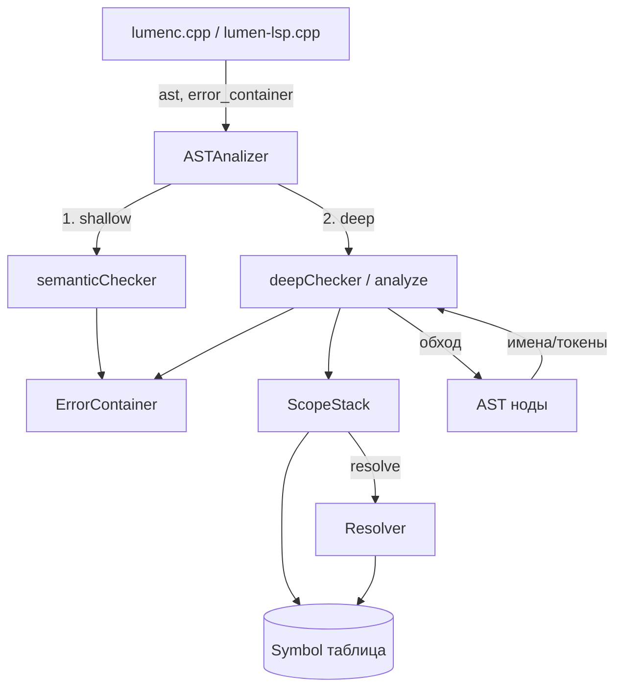
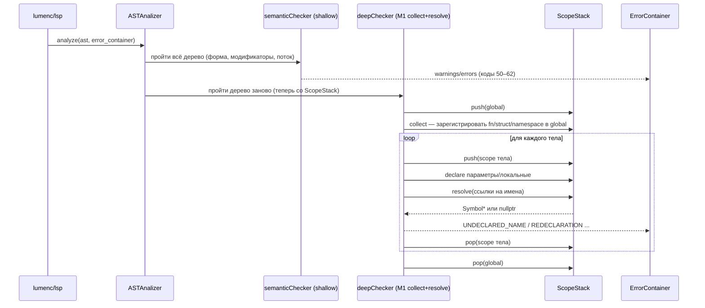
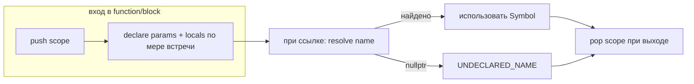
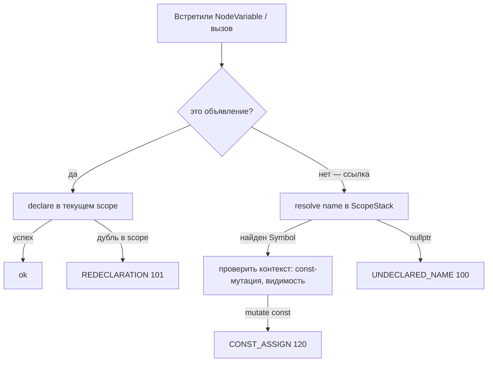
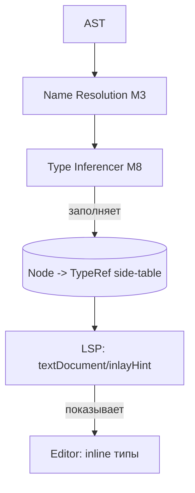
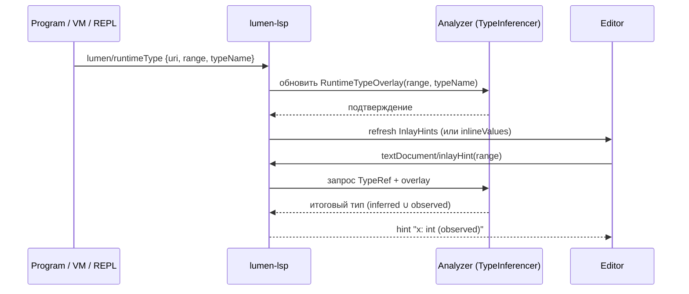
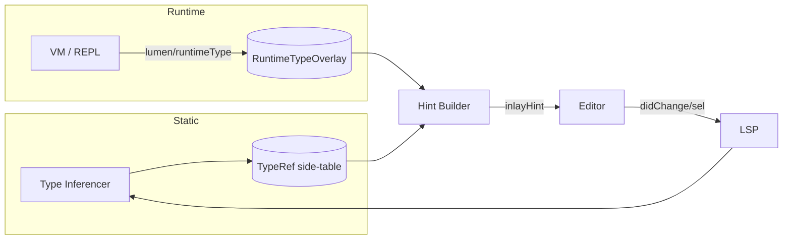

# Lumen — Глубокая семантическая фаза: план (M1–M7)

> Продолжение `compiler/todo.md`. Поверхностный Pass 1 завершён; здесь — проект
> инфраструктуры и диагностик глубокой фазы (Pass 2), которая опирается на
> таблицу символов (SymbolTable / ScopeStack) и разрешение имён.

---

## 1. Цель и место в архитектуре

Динамическая система типов: совместимость типов уходит в рантайм, но **имена,
области видимости, переобъявления, аргументы вызовов, члены struct/namespace и
поток управления** — это статическая семантика, которую ловим на этапе компиляции.

Порядок (уже заложен в `ASTAnalizer::operator()()`):

```
shallow (semanticChecker)  ──►  deep (deepChecker / analyze)
   форма, модификаторы,         имена, области видимости,
   поток без имён              переобъявления, вызовы, члены
```

Глубокая фаза **не может начаться** без M1 (ScopeStack + Symbol + обход
collect/resolve). M1 — это и есть следующий гейт.

---

## 2. Системы (компоненты) и их ответственность

| Система | Файл (предл.) | Ответственность |
|---|---|---|
| `ASTAnalizer` (оркестратор) | `SemanticAnalizer.cpp` | запускает shallow, затем deep; владеет `ast`, `error_container`, `scope_stack` |
| `ScopeStack` | `SemanticAnalizer.cpp` (внутри) | стек областей `map<name, Symbol>`; `push/pop`, `declare`, `resolve` |
| `Symbol` | `SemanticAnalizer.cpp` | запись о имени: вид, `typeRef`, `is_const`, токен декларации |
| `Resolver` | метод `ScopeStack::resolve` | поиск имени сверху вниз по стеку (теневание бесплатно) |
| `ErrorContainer` + `BaseError` | `ErrorBase.cpp` | приём диагностик (коды 100+) |
| AST-ноды | `core/Nodes/*` | источник фактов (имена, токены, дети) |
| Входы | `lumenc.cpp`, `lumen-lsp.cpp` | создают `ASTAnalizer(ast, error_container)`, вызывают `analyze()` |

---

## 3. Модель данных

### 3.1 `Symbol`

```cpp
enum class SymbolKind {
    Variable, Parameter, Function, Struct, Namespace, GenericParam
};

struct Symbol {
    String        name;
    SymbolKind    kind;
    TypeRef       type_ref;     // лёгкая ссылка на тип (см. 3.3)
    bool          is_const = false;
    Token         decl_token;   // позиция объявления (для relatedInformation)
    ScopeStack*   member_scope = nullptr; // для Struct/Namespace: их собственная область
};
```

### 3.2 `ScopeStack`

```cpp
struct Scope {
    std::map<String, Symbol> locals;
    // для Struct/Namespace-областей — указатель на их Symbol, чтобы резолвить члены
    Symbol* owner = nullptr;
};

struct ScopeStack {
    std::vector<Scope> frames;

    void push(Symbol* owner = nullptr);
    void pop();
    bool declare(const Symbol& s);          // false, если уже есть в ТЕКУЩЕЙ области
    Symbol* resolve(const String& name);    // сверху вниз; nullptr, если нет
    Symbol* resolveMember(Symbol* owner, const String& name); // члены struct/namespace
};
```

**Правила:**
- `resolve` идёт от `frames.back()` к `frames[0]` → теневание (shadowing) работает
  автоматически: локальная переменная перекрывает внешнюю.
- `declare` добавляет только в `frames.back()`; дубликат в **одной** области →
  `REDECLARATION`.
- Область struct/namespace — это `Scope` с `owner != nullptr`; её члены резолвятся
  через `resolveMember`.

### 3.3 `TypeRef` (лёгкая)

```cpp
struct TypeRef {
    String type_name;   // имя типа (для reified-Type позже)
    bool   is_const = false;
    // полной TypeDesc пока нет — достаточно имени + const (по заметке в todo.md)
};
```

---

## 4. Диаграмма компонентов



---

## 5. Поток анализа (оркестрация)



---

## 6. Взаимодействие ScopeStack ↔ Resolver (жизненный цикл областей)



**Теневание:** `resolve("x")` смотрит `frames.back()` первым. Локальный `x`
перекрывает глобальный — коллизии нет, предупреждение не нужно (это норма).

**Переобъявление:** `declare` в той же `frames.back()` с уже существующим
`name` → `REDECLARATION` (используем `decl_token` найденного символа для
подсказки «Declared here»).

---

## 7. Разрешение одного имени: пошаговый поток



Для `a.b` / `ns::x` поток расширяется: сначала `resolve(a)` → получаем `Symbol`
с `member_scope`, затем `resolveMember(symbol, "b")`.

---

## 8. Этапы и диагностики

| Этап | Что делаем | Коды (из todo.md) |
|---|---|---|
| **M1** | `ScopeStack` + `Symbol` + collect/resolve-обход; глобальный пре-пасс (собрать fn/struct/namespace, чтобы работали прямые ссылки вперёд) | — (инфраструктура) |
| **M3** | Имена: `UNDECLARED_NAME`, `REDECLARATION`, стек областей | 100, 101 |
| **M4** | Вызовы: `CALL_ARG_COUNT`, `GENERIC_ARG_COUNT`, резолюция callee | 110, 130 |
| **M5** | Struct/namespace: `NO_SUCH_MEMBER`, `ns::x` | 111 |
| **M6** | Модификаторы/поток: `CONST_ASSIGN`, `MISSING_RETURN`, `UNREACHABLE_CODE` | 120, 121, 122 |
| **M7** | (опц.) аннотация узлов `typeRef` для codegen; полировка диагностик | — |

Коды семантики глубокой фазы — **100+** (чтобы не пересекаться с 50–62 shallow).

### 8.1 Глобальный пре-пасс (важная деталь M1)
Чтобы `fn main()` могла вызвать `fn helper()`, объявленную **ниже** в файле,
сначала один проход собирает ВСЕ именованные декларации верхнего уровня
(fn/struct/namespace, их generic-параметры) в глобальную область. Только потом —
resolve тел. Иначе прямые ссылки вперёд ловят ложный `UNDECLARED_NAME`.

---

## 9. Интеграция и сборка

- Входы (`lumenc.cpp`, `lumen-lsp.cpp`) уже создают `ASTAnalizer(ast, error_container)`
  и вызывают анализ; ошибки попадают в тот же `error_container`.
- Нюанс сборки из `todo.md`: `SemanticAnalizer.cpp` включает `ASTGenerator.cpp`,
  поэтому при компиляции `lumenc.cpp` НЕ включаем `ASTGenerator.cpp` повторно
  (иначе дубли определений). Текущая схема (`lumenc.cpp` → `SemanticAnalizer.cpp`
  → `ASTGenerator.cpp`) этому удовлетворяет.
- Метод-оркестратор: `analyze()` вызывает `semanticChecker()` затем `deepChecker()`
  (сейчас `deepChecker` — пустой TODO; его и наполняем в M1).

---

## 10. Открытые вопросы

1. **Generic-параметры** (`fn foo[T]()`): резолвить ли `T` как `GenericParam`
   в области функции, и как проверять `GENERIC_ARG_COUNT` без типов?
2. **Лямбды**: собственная область + захват (`global`?). Нужен ли отдельный scope
   для замыканий в M1?
3. **Видимость `private/public`** (уже помечаем в shallow) — в deep проверять
   доступ к `private`-члену извне struct (требует знать «текущий struct» при
   резолюции `a.b`).
4. **`const`-мутация**: `const let x = 5; x = 6;` → `CONST_ASSIGN`. Нужно
   протащить `is_const` из Symbol в проверку присваивания (левая часть —
   `NodeVariable` с резолвом в Symbol).
5. **Overload/override** для `final`: `final` запрещает переопределение — нужен
   ли механизм наследования struct в этом языке вообще?

---

## 11. Критерий готовности M1 (гейт к M3)

M1 считается закрытым, когда:
- [ ] есть `ScopeStack` + `Symbol` + `resolve`/`declare`/`push`/`pop`;
- [ ] `deepChecker` делает глобальный пре-пасс (сбор fn/struct/namespace);
- [ ] `deepChecker` обходит тела с корректным push/pop областей;
- [ ] для `NodeVariable` (ссылка) вызывается `resolve`, и при отсутствии имени
      выдаётся `UNDECLARED_NAME` (100) с токеном;
- [ ] для повторного `let` в той же области выдаётся `REDECLARATION` (101).

---

## 12. Глубокая система типов с авто-выводом (M8)

### 12.1 Цель
Язык динамически типизирован (значения несут reified `Type` в рантайме), но для
**обучения и удобства** на этапе анализа мы строим *статический вывод типов*
(аналог gradual typing): где можем — выводим конкретный тип, где нет — помечаем
как `dynamic`/`any`. Результат кладём в `typeRef` каждой ноды (см. M7) и отдаём
в редактор как инлайн-хинты, а рантайм может *уточнять* типы обратной связью.

### 12.2 Представление типа
```cpp
struct TypeRef {
    String        name = "dynamic";     // "int" | "float" | "bool" | "string"
                                        // | "array<T>" | "fn" | "struct:Name"
                                        // | "dynamic" | "void"
    bool          is_const = false;
    // для динамики: множество типов, реально встретившихся в рантайме
    std::set<String> possible_runtime;  // пусто => не наблюдалось
    bool          explicit_annotated = false; // тип задан программистом явно?
};
```
Статический вывод даёт `name`; рантайм-фидбек (M9) наполняет `possible_runtime`
и при желании уточняет `name` для отображения.

### 12.3 Алгоритм вывода (правила)
Вывод идёт **после** разрешения имён (M3): нужны Symbol, чтобы знать тип
переменной и возвращаемое значение функции.

| Конструкция | Выводимый тип |
|---|---|
| `5`, `0xFF` | `int` |
| `5.0`, `1e3` | `float` |
| `"x"`, `` `raw` `` | `string` |
| `true`/`false` | `bool` |
| `null` | `null` (→ совместим с любым ссылочным) |
| `[a, b, c]` | `array<T>` где `T` — общий тип элементов (`dynamic`, если разные) |
| `fn (p) {…}` | `fn` (с сигнатурой при наличии) |
| `let x = e` | `type(e)` (копия typeRef `e`) |
| `const let x: T = e` | `T`, при конфликте с `type(e)` — пометка `TYPE_MISMATCH` (warning) |
| `x` (ссылка) | `Symbol.type_ref` |
| `a + b`, `*`, `/` … | общий числовой тип; смешанное → `dynamic` |
| `a == b`, `!x` | `bool` |
| `f(args)` | возврат функции `f` (из её Symbol / вывода тела) |
| `a.b`, `ns::x` | тип члена (резолв через `member_scope`) |
| `if (c) a else b` | объединение `type(a) ∪ type(b)` (для показа — `dynamic`, если разные) |
| `while(…){…}` | тело может не выполниться → мутации внутри не сужают тип переменной |
| `new T`, `struct` | `struct:Name` / `T` |

Для рекурсивных функций и взаимных ссылок — один проход с
«тип-заглушкой» (`dynamic`), при необходимости лёгкий fixpoint (1–2 итерации).
Для учебного языка достаточно однопроходного вывода сверху вниз со значением
по умолчанию `dynamic`.

### 12.4 Аннотация нод (`typeRef`)
Каждая выраженческая нода получает заполненный `TypeRef` (в M7 планировалось
проставить `typeRef` — M8 его и наполняет). Это side-table
`Node* → TypeRef` (или поле в ноде) — источник данных для M9 (хинты) и для
будущего codegen.

### 12.5 Gradual typing: конфликт инференса с явной аннотацией
Если программист написал `const let x: int = "строка";`, статический вывод
видит конфликт литерала и аннотации → `TYPE_MISMATCH` (код **140**, warning,
не блокирует — типы всё равно динамические). Явная аннотация — это *подсказка*
анализатору и редактору, не жёсткое ограничение (по духу динамического языка).

---

## 13. LSP — обратная связь от рантайма и инлайн-хинты (M9)

### 13.1 Поток статического вывода типов


### 13.2 Петля рантайм-фидбека (live types)
Рантайм (VM/интерпретатор, отладочный трейс или REPL) наблюдает реальные
reified-типы и шлёт их в LSP. Анализатор кладёт их в **RuntimeTypeOverlay**
(отдельно от статического вывода — чтобы не ломать статику) и обновляет хинты.



### 13.3 Inlay hints (показ типов в редакторе)
LSP-метод `textDocument/inlayHint`. Правила показа (чтобы не засорять):
- показывать **только для выведенных** типов (`explicit_annotated == false`);
- у переменных — после имени: `let x /*: int*/`;
- у функций без явного возврата — после `)` : `fn f() /*-> bool*/`;
- у цепочек — опционально, по настройке;
- при наличии рантайм-наблюдения — показывать наблюдённый тип с пометкой
  `(runtime)` / `(observed)`.

### 13.4 Кастомный LSP-метод обратной связи
```
lumen/runtimeType(notification):
    params: { textDocument: { uri }, range: Range, typeName: string }
```
Анализатор хранит overlay `map<DocumentUri, map<Range, set<string>>>`. При
запросе хинта итоговый тип = статический `TypeRef.name`, расширенный
наблюдёнными `possible_runtime` (для показа joining через `|`, напр.
`int | string`).

### 13.5 Взаимодействие систем (сводно)


---

## 14. Обновлённый список этапов

| Этап | Содержимое |
|---|---|
| M1 | `ScopeStack` + `Symbol` + collect/resolve (гейт) |
| M3 | имена: `UNDECLARED_NAME` (100), `REDECLARATION` (101) |
| M4 | вызовы: `CALL_ARG_COUNT` (110), `GENERIC_ARG_COUNT` (130) |
| M5 | struct/namespace: `NO_SUCH_MEMBER` (111) |
| M6 | модификаторы/поток: `CONST_ASSIGN`(120), `MISSING_RETURN`(121), `UNREACHABLE`(122) |
| M7 | аннотация нод `typeRef` (инфраструктура для M8) |
| **M8** | **вывод типов: `TypeRef` для всех выражений, gradual typing, `TYPE_MISMATCH` (140)** |
| **M9** | **LSP: рантайм-фидбек (`lumen/runtimeType`) + inlay hints типов** |

Коды глубокой фазы: имена/вызовы/члены/поток — **100–122** (из todo.md);
типы — **140+** (`TYPE_MISMATCH` = 140), чтобы не смешивать с проверками имён.

---

## 15. Открытые вопросы по типам

1. **Объединения типов при ветвлении:** показывать `int | string` или просто
   `dynamic`? Для обучения явное объединение понятнее, но шумнее.
2. **Фикспоинт для рекурсии:** достаточно ли одного прохода со значением
   `dynamic` по умолчанию, или нужен итеративный пересчёт возвратов?
3. **Рантайм-фидбек источник:** откуда приходит `lumen/runtimeType` — из
   отладчика, из трейса исполнения, или из «живого» REPL в редакторе?
4. **Жизненный цикл overlay:** сбрасывать ли рантайм-типы при каждом
   `didChange` (recompile) или хранить между запусками сессии?
5. **Конфликт статического и наблюдённого:** если статикой выведен `int`, а
   рантайм прислал `string` — показывать оба (`int (static) / string (runtime)`)
   или только рантайм?
6. **Generics + вывод:** `fn id[T](x: T) { return x }` — выводить `T` из
   аргумента вызова (например, `id(5)` → `T=int`)?

