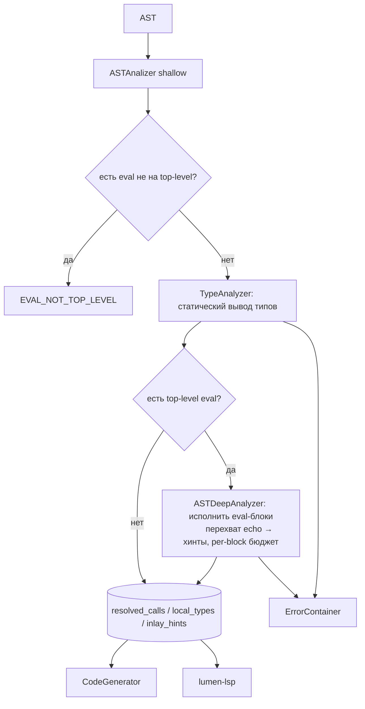

# Lumen — Тип-ориентированный анализ (без исполнения) + блок `eval { ... }`: план

> Продолжение `deep-plan.md` / `ASTDeepCheckerRealization.md`. Задача: убрать
> **исполнение кода** из обязательного пути компиляции (сейчас `DeepAnalizer` —
> абстрактный интерпретатор, который крутит циклы до 10000 итераций и до 50000
> вызовов и на «настоящих» вычислениях либо тормозит, либо обрывается по бюджету),
> заменив его статическим выводом типов. Явное вычисление на этапе компиляции
> остаётся, но **только** внутри блоков `eval { ... }` на верхнем уровне.

---

## 1. TL;DR

- Основной проход компиляции (`lumenc` без флагов, `lumen-lsp`) должен **только
  анализировать типы**, не выполняя тела циклов/функций больше одного раза и не
  моделируя кучу/значения.
- Новый движок `TypeAnalyzer` (предлагаемый файл `compiler/TypeAnalyzer.cpp`)
  строит статический тип каждого выражения, `resolved_calls` (резолв перегрузок
  для кодогена), `local_types`/`inlay_hints` (для LSP) и диагностики.
- Существующий `ASTDeepAnalyzer` **не выбрасывается**: он превращается в
  *опциональный интерпретатор*, работающий при `-r`, `-bench` и для блоков `eval`.
- Новое ключевое слово **`eval { ... }`** — блок, **всё содержимое которого
  вычисляется** интерпретатором на этапе компиляции. Такой блок разрешён
  **только на верхнем уровне (глобальная область)**; иначе — ошибка. Вне `eval`
  код **не исполняется**.
- У **каждого** `eval`-блока **свой бюджет на циклы**: он не даёт блоку
  «зависнуть»; при исчерпании — ошибка, а не бесконечное вычисление.
- Внутри `eval` можно `echo/out/outln` — их вывод **перехватывается** и
  показывается **инлайн-хинтами** в редакторе.
- Что теряем: часть проверок времени исполнения (OOB, деление на ноль, разыменование
  `null`, `assert`, «цикл не завершается»). Митигация: const-folding для
  константных операндов + runtime-проверки в кодогене (они там уже частично есть) +
  опциональный строгий режим `-deep`.

---

## 2. Проблема: почему исполнение в анализе — тупик

`ASTDeepAnalyzer` — не «анализ типов», а **интерпретатор** со значениями `Value`,
`Context`, `VirtualHeap`:

- `execute()` (`DeepAnalizer.cpp:2632`) / `executeInner()` (`:2644`) рекурсивно
  выполняют AST.
- `NodeWhile` (`:4964`) и `NodeFor` (`:4996`) **реально крутят тело** до
  `iter_budget = 10000` (`:288`); при исчерпании — `LOOP_NOT_TERMINATING`.
- Вызовы функций реально исполняются, до `CALL_BUDGET_LIMIT = 50000` (`:311`) и
  `CALL_DEPTH_LIMIT = 32` (`:337`).
- Есть dry-прогон мёртвых веток (`:136`, `:4902`) и куча костылей ради
  производительности (`deadBranchIsPure`, `ctx_pool`, `local_owner`).

Отсюда:
1. **Время и предсказуемость**: анализируемое время пропорционально времени
   выполнения программы, а не её размеру. Программы с тяжёлым циклом/рекурсией
   «зависают» или обрезаются.
2. **Ложные диагностики**: обрыв по бюджету рождает `LOOP_NOT_TERMINATING` там,
   где программа прекрасно завершается.
3. **Сложность**: кучу/ref/указатели/`dunder` приходится моделировать только
   ради того, чтобы получить *типы*.
4. **Хрупкость**: любое изменение рантайм-семантики тянет правки интерпретатора.

При этом **значения** большинству потребителей не нужны — см. §4.

---

## 3. Карта текущего `DeepAnalizer` (что и зачем)

| Механизм | Где | Зачем сейчас | Судьба |
|---|---|---|---|
| `execute/executeInner` | `:2632/:2644` | исполнение выражений/операторов | → интерпретатор (по запросу / `eval`) |
| циклы с бюджетом | `:4964/:4996` | «проиграть» цикл ради типов/значений | → `TypeAnalyzer`: один проход + widening |
| `call_budget`/`call_depth` | `:300/:295` | защита от рекурсии | → интерпретатор (по запросу / `eval`) |
| `VirtualHeap`, `Context`, `ctx_pool` | `:264/:265/:269` | модель памяти | → интерпретатор только |
| `resolved_calls` (`Node*→Node*`) | `:376` | резолв перегрузок для кодогена | → `TypeAnalyzer` (по статич. типам) |
| `local_types` (`map<u64,Type>`) | `:369` | reified-тип локалов для LSP | → `TypeAnalyzer` (+ `eval`) |
| `inlay_hints` | `:366` | инлайн-хинты типов и значений `echo` | → `TypeAnalyzer` (типы) + `eval` (значения) |
| `NodeTypeOf::static_type*` | `:5081` | `typeof(x)::type`/`::size` в кодогене | → `TypeAnalyzer` |
| диагностики `DEEP_ERRORS::*` | `ErrorBase.cpp` | глубокие проверки | частично в `TypeAnalyzer`, runtime-часть → кодоген |

Контроль потока (`break/continue/return`) — `:278`, `:5035`, `:5043`.

---

## 4. Что реально нужно потребителям (по фактам кода)

Потребители читают **решения и типы**, а не значения:

- **`CodeGenerator.cpp`**
  - `resolved_calls` — конструктор кодогена (`:379-391`), `sigFromResolvedCall`
    (`:1820-1834`), `resolveForCall` (`:1837-1873`), `resolveForMethod`
    (`:1875-1918`). В `lumenc.cpp:241` передаётся
    `run_deep ? &deep_analizer.resolved_calls : nullptr`.
  - `NodeTypeOf::static_type` / `static_type_elem` — эмиссия
    `rt::Box::typ(...)` (`CodeGenerator.cpp:777-780`, `:903`).
  - **Ключевой факт**: путь `-noanalize` (передаём `nullptr` вместо
    `resolved_calls`) уже доказал, что кодоген работоспособен без глубокого
    анализа — он откатывается на свой runtime-dispatch fallback
    (`CodeGenerator.cpp:1807`). Значит, задачи `TypeAnalyzer` —
    **улучшение качества** (точные сигнатуры, меньше runtime-диспетча),
    а не обязательное условие корректности.
- **`lumen-lsp.cpp`** — `inlay_hints` (`:193-194`), `local_types` (`:829-841`,
  `:1522`). Нужны **типы**, стабильные между сборками. LSP **сегодня** запускает
  интерпретатор на всём файле (`lumen-lsp.cpp:191-192`) именно ради этих хинтов —
  и потому большие циклы подвешивают редактор.
- **Диагностики** — в общий `error_container` (`ErrorBase.cpp`).

Вывод: убрав исполнение, мы **сохраняем все потребительские контракты**, если
`TypeAnalyzer` умеет: (а) вывести тип выражения; (б) разрешить перегрузку вызова;
(в) сформировать хинты локалов. Отдельно `eval`-блоки возвращают вычисленные
значения (в т.ч. `echo`).

---

## 5. Целевая архитектура: два движка

```
                  ┌─────────────────────────────┐
   AST ─────────► │  ASTAnalizer (shallow)      │  структурные проверки (коды 50–62)
                  └──────────────┬──────────────┘
                                 ▼
                  ┌─────────────────────────────┐
                  │  TypeAnalyzer (default)     │  статический вывод типов, без исполнения
                  │   • StaticTable (символы)   │  → resolved_calls, local_types, inlay_hints
                  │   • summaries функций       │  → DEEP_ERRORS (статические)
                  │   • сбор top-level eval     │  → провизии EVAL_NOT_TOP_LEVEL
                  └──────────────┬──────────────┘
                                 │  (только если -r / -bench / есть eval-блоки)
                                 ▼
                  ┌─────────────────────────────┐
                  │  ASTDeepAnalyzer (interp)   │  сегодняшний движок: исполняет код
                  │   • совместимый API         │  → значения, eval-константы, echo-хинты
                  └─────────────────────────────┘
```

- **По умолчанию** в `lumenc` (без `-r`/`-bench`) и в LSP работает только
  `TypeAnalyzer`.
- **`-r` / `-bench`**: `TypeAnalyzer` можно пропустить (интерпретатор даёт всё),
  либо прогнать оба и сверить (этап отладки).
- **`eval { ... }`** на верхнем уровне — сигнал запустить интерпретатор **только**
  для этих блоков (см. §11).

Интерфейс, который обязан сохранить `TypeAnalyzer` (сохранить обратную
совместимость с `lumenc.cpp:195-241`):

```cpp
struct TypeAnalyzer {
    TypeAnalyzer(AbstractTreeT ast, ErrorContainer& err);
    std::map<Node*, Node*> resolved_calls;         // тот же тип
    std::map<unsigned long long, Type> local_types;
    std::vector<InlayHintData> inlay_hints;         // + хинты значений из eval
    bool aborted = false;
    void operator()();
};
```

---

## 6. Абстрактный домен

Вместо `Value` (+куча) вводится лёгкое описание:

```cpp
// «статическое значение» = тип + опциональная константа + свойства места.
struct StaticValue {
    Type        type      = Ty::Any;  // reified-тип (переиспользуем Type::operator>>)
    bool        is_const  = false;    // значение известно на этапе компиляции
    Value       constant  = new_null(); // задел под const-folding (только примитивы)
    bool        is_lvalue = false;    // присваиваемое место (для CONST_ASSIGN)
    bool        is_ref    = false;    // живая ссылка (для VALUE_RETURNS_REF)
    bool        nullable  = false;    // может быть null (для диагностик)
    bool        dynamic   = false;    // тип не выводится (Any/union) → runtime-dispatch

    static StaticValue unknown() { return {}; }
};
```

Правила:
- `dynamic == true` ⇔ `type == Ty::Any` или union из >1 несовместимого типа.
- `constant` заполняется **только** для литералов и чисто-константных операций
  (это то, что позволяет сохранить const-folding `1/0`, `arr[5]`). Значения из
  `eval`-блоков тоже приходят сюда как `is_const`.
- `is_lvalue` заменяет дорогой `isAssignablePath()` (`:1462`) — статическая
  память о «месте».

Окружение — стек областей:

```cpp
struct StaticScope {
    std::map<String, StaticValue> vars;   // локальные имена
};
struct StaticTable {
    std::vector<StaticScope> frames;      // push/pop по областям
    // глобальные: функции, структуры, namespace — отдельные карты
};
```

---

## 7. Правила вывода типов (выражения)

Переиспользуем существующую логику `staticTypeOfExpr()` (`DeepAnalizer.cpp:488`),
`resultTypeOf()` (`:646`), `commonElementType()` (`:1977`), но без вычисления
значений.

| Выражение | Статический тип |
|---|---|
| `NodeNumber` | `i64`/`f64` (по литералу) + `is_const` |
| `NodeString`/`` `raw` `` | `str` |
| `NodeBool` | `bool` |
| `NodeNull` | `null`, `nullable=true` |
| `NodeVariable` | тип из `StaticTable`; `is_const` из символа |
| `NodeArray` | `Array[T]`, `T = commonElementType(...)` |
| `a + b`, `*`, `/` … | `resultTypeOf(a,b)`; при разных числовых → `Any` |
| `a == b`, `!x`, сравнения | `bool` |
| `x && y`, `x || y` | `bool` (short-circuit — отдельно для потока, §8) |
| `NodeArrayAccess` | `elem(base)`; индекс — `i64` |
| `NodeMemberAccess` | тип поля из `StructSymbol` (`:446/:465`) |
| `a::b` (scope resolution) | тип члена namespace/enum |
| `NodeFunctionCall` | тип возврата по `summary` (или `Any`) + `resolved_calls[node]` |
| `NodeCast` (`as T`) | целевой тип |
| `NodeTypeOf` | `Type`-значение; попутно пишем `static_type*` (§4) |
| `NodeSizeOf` | `i64` (const, если размер известен статически) |
| `NodeMod` | `bool` (const, если операнд const) |
| `fn(...) {...}` (lambda) | `fn` с сигнатурой |
| `new T` | `T` (ссылочный) |

Специально **не** пытаемся вывести содержимое контейнеров, значение `ref`,
адреса — это `Any`. Глобальные переменные, вычисленные в `eval`, приходят сюда
как const-значения (см. §11).

---

## 8. Ветвления и циклы: merge без исполнения

### 8.1 `if/else`
1. Анализ `condition` → тип `bool` (+ `is_const`, если сворачивается).
2. Если `condition.is_const` — идём только в **живую** ветку; мёртвую не
   исполняем и не «проигрываем» (в отличие от `deadBranchIsPure`, `:136`) —
   просто пропускаем (диагностика `UNREACHABLE` при необходимости ставится здесь).
3. Если не const — анализируем **обе** ветки в **копиях** окружения (лёгких, без
   кучи), затем **сливаем**:
   - для каждой переменной: `type = union(тип_до, тип_в_then, тип_в_else)`;
   - если union не выразим — `Any` (`dynamic`).
4. Union реализуем как объединение `Type` с правилом «разное → `Any`» (для
   обучения можно показывать `int | str` в хинтах отдельно — см. `deep-plan.md §15`).

### 8.2 Циклы (`while`/`for`) — **один проход**
1. Проанализировать `init` (для `for`) в области цикла.
2. **Расширить (widen)** инварианты: переменные, изменяемые в теле, заранее
   получают `union(начальный_тип, Any)` — т.е. обычно `Any`, если тип может
   меняться. Если изменение только присваиванием того же типа — тип сохраняется.
3. Проанализировать **тело ровно один раз** (не N раз), собрать изменения.
4. Повторить проход **один раз** для уточнения (достигаем фикспоинта за ≤2
   итерации); если после второй итерации тип «расходится» — фиксируем `Any`.
5. **Никогда** не выполняем тело 10000 раз и **не** выдаём
   `LOOP_NOT_TERMINATING` по бюджету (диагностика «цикл не завершается» возможна
   только эвристически — см. §12).

Итог: время анализа циклов — **O(размер тела)**, не зависит от числа итераций.
Это касается циклов **вне `eval`**; внутри `eval` циклы реально исполняются, но
ограничены бюджетом блока (§11.4).

### 8.3 `break`/`continue`/`return`
- `TypeAnalyzer` отслеживает `control_flow` **без исполнения**: при встрече
  `break`/`continue` — прекращает линейный анализ остатка тела (достижимость).
- `return e` — добавляет `type(e)` в набор возвратов функции (для summary, §9).

---

## 9. Function summaries (возвраты, рекурсия)

Двухпроходная схема:

1. **Collect-проход**: собрать все `NodeFunctionDeclaration` (имя, параметры с
   типами по умолчанию, объявленный `-> T`), `StructSymbol` (поля/методы),
   namespace. Глобальная таблица — как в `deep-plan.md §8.1`. Здесь же
   собираются top-level `eval`-блоки (и проверяется их размещение, §11.2).
2. **Summary-проход**: для каждой функции — если объявлен `-> T` и `T != auto`,
   summary.ret = `T`; иначе в начале `Any`, затем уточняем по `return`-выражениям
   (`union` всех возвратов; fall-through → `null`).
3. **Рекурсия**: если функция вызывает себя/цикл взаимных вызовов — её summary
   берётся как есть на текущей итерации; делаем **≤2 итерации** уточнения, дальше
   фиксируем `Any`. Никакого `CALL_DEPTH_LIMIT`.
4. **Side effects** (мутации аргументов, `ref`) — не моделируем: для типов они не
   нужны. `ref`/указатели → `Any`.

Вызов без найденного тела (extern`/`#cppinclude`) → тип из объявленной сигнатуры,
иначе `Any`.

---

## 10. Резолв перегрузок (`resolved_calls`) без исполнения

Кодогену нужна **та же** перегрузка, что выбрал бы интерпретатор. Алгоритм:

1. Для `NodeFunctionCall` вычисляем статические типы аргументов (§7).
2. Ищем кандидатов (функции/методы/`dunder`) по имени; для методов — по
   статическому типу получателя (`StructSymbol.methods`, `:91`).
3. Отбор по совместимости: переиспользуем логику `argCompatible`
   (`CodeGenerator.cpp:1811`) и `sigFromResolvedCall` — но теперь доступен
   `staticTypeOfExpr`.
4. Если тип хотя бы одного аргумента `Any` и кандидатов с совместимой
   сигнатурой несколько — **не** фиксируем решение (`resolved_calls[node]` не
   заполняем) → кодоген использует свой runtime-dispatch fallback
   (`CodeGenerator.cpp:1807`). Это безопасно и уже поддержано.
5. Если решение однозначно — пишем `resolved_calls[node] = decl`, как сегодня
   (`DeepAnalizer.cpp:376`).

Формально: `resolved_calls` становится «best-effort» — покрывает большинство
статически-типизированных вызовов; неоднозначные оставляем рантайму.

**Реализовано (M4, v1):** пред-проход `collectFunctions` собирает top-level
`NodeFunctionDeclaration` (не заходя в тела и namespace) в `fn_summaries`
(`std::map<String, std::vector<FnSummary>>`), где `FnSummary` хранит `decl`,
типы параметров (`ParamSummary`: concrete / generic / auto, наличие дефолта) и
объявленный `-> T`. `chooseOverload(name, args)` сопоставляет статические типы
аргументов с параметрами (exact → convert через `Type::operator>>` → слабое),
отбрасывает неподходящих кандидатов и выбирает доминирующую перегрузку по
правилам интерпретатора (`(ранг совпадения, специфичность)` позиционно); при
неоднозначности/отсутствии совпадений возвращает `nullptr` — тогда
`resolved_calls[node]` **не** заполняется (кодоген берёт fallback). Именованные
аргументы и вызовы через переменную не резолвятся (возврат `Any`).
Проверено: генерация C++ с `-types` **байт-в-байт совпадает** с
интерпретаторным `resolved_calls` на статически-типизированных пробах
(перегрузки `i64`/`f64`/`str`, дефолтные параметры); регрессия 66/0.

**Реализовано (M4, методы):** отдельный проход `collectStructs` собирает
`StructSym` (типы полей, в т.ч. `static`; методы по имени с флагом `static`).
`typeFromTypeExpr` узнаёт имена структур (`Type::StructType`), `NodeStructLiteral`
и `NodeMemberAccess` выводят тип структуры/поля. Для `NodeFunctionCall` резолвятся:
instance-методы (`recv.m(args)`, `skipSelf`), static-методы и `__call__`
(`Struct::m`/`Struct(args)`), плюс квалифицированные `Ns::fn`. Область:
**только не-generic структуры** — для `struct[T]` методы/`__call__` требуют
вывода struct-generic и в кодогене дают занижение generic-hidden-аргументов
(`Box::null()`), поэтому такие вызовы сознательно не резолвим (остаётся
fallback/runtime, как и было до M4). Замер по регрессии: рантайм-сверка
`default` vs `-types` на 52 пробах — было 11 расхождений, стало 10 (исправлена
`m19`), новых не появилось; оставшиеся — пред-существующие пробелы `-types`
(`typeof`/`static_type`, регистрация тип-констант в `g_ctx`), вне объёма M4.
Отличия от интерпретатора сейчас: union-суммы возвратов (`Any`) и generic-структуры.
_(Исторический замер M4, когда default был интерпретатор. M9 закрыл эти пробелы
`typeof`/`static_type` и включил `TypeAnalyzer` по умолчанию — см. §16.1.)_

---

## 11. Блок `eval { ... }`

### 11.1 Синтаксис
```
eval {                              // вычисляется на этапе компиляции
    let table = buildTable();       // buildTable() выполняется здесь
    let n = table.size();
    echo "n =", n;                  // вывод перехватывается → инлайн-хинт
    for i in 0..n { ... }
}

let x = table[0];                   // table — глобальная compile-time-константа
```
`eval` — новое ключевое слово (`Literals::KEYWORDS`, `LangSpec.cpp:11-49`),
открывает блок-оператор `eval { ... }`. AST — новая нода `NodeEvalBlock`
(или флаг на `NodeStatementsScope`). **Две формы тела:** блок `eval { ... }`
либо **одиночный стейтмент** `eval <стейтмент>` (например,
`eval let x = 2 + 2;` или `eval echo x;`) — обе равнозначны.

### 11.2 Размещение — только верхний уровень (жёсткое правило)
- `eval { ... }` разрешён **только в глобальной области (top-level)**.
- Внутри функции/лямбды/любого блока/тела цикла/`if` — **ошибка**
  `DEEP_ERRORS::EVAL_NOT_TOP_LEVEL` (код **128**).
- Вложенные `eval` запрещены тем же правилом (внутренний уже не top-level).
- Проверяется статически (shallow/collect-проход `TypeAnalyzer`) **до** всякого
  вычисления — «плохой» блок не исполняется вовсе.

### 11.3 Семантика
- **Всё содержимое блока вычисляется** интерпретатором (`ASTDeepAnalyzer`) на
  этапе компиляции — в **глобальном контексте**.
- `let`/`const` внутри блока становятся **глобальными compile-time-константами**
  (значения «замораживаются»); после блока доступны как обычные глобальные
  переменные с известным значением (`StaticValue::is_const`).
- `echo/out/outln` **разрешены**: их вывод **не** идёт в реальный stdout, а
  **перехватывается** и превращается в **инлайн-хинты редактора** (как сегодня
  `DeepAnalizer.cpp:4115-4132`) / виртуальный вывод. Это и есть «показывать `echo`
  инлайн» — но только внутри `eval` (вне `eval` код не исполняется, значит
  значение неизвестно и хинта нет).
- Запрещено (иначе `DEEP_ERRORS::EVAL_NOT_CONST`, код **129**):
  - `input` (блокирует на stdin);
  - `extern fn` / `#cppinclude` (как `interpret_mode`, `:307`);
  - недетерминизм и I/O кроме `echo/out/outln`;
  - адреса/указатели, утекающие из блока.
- Вне `eval` код **не исполняется** — только статический вывод типов (§7–§10).

### 11.4 Бюджет циклов — отдельный на каждый блок
- У **каждого** `eval`-блока **свой** бюджет итераций циклов
  (`EVAL_LOOP_BUDGET`; ориентир по умолчанию — текущий `iter_budget = 10000`,
  `:288`, можно сделать настраиваемым).
- Бюджет общий на все циклы **внутри одного** блока (вложенные циклы его делят),
  но **не** переносится и **не** суммируется между разными блоками.
- При исчерпании — `DEEP_ERRORS::EVAL_BUDGET_EXCEEDED` (код **130**)
  с указанием блока/цикла. Блок **не зависает**; его незавершённые результаты не
  замораживаются.
- Защиты от рекурсии (`CALL_DEPTH_LIMIT`/`CALL_BUDGET`) внутри `eval` тоже
  действуют и относятся к бюджету того же блока.

### 11.5 Где исполнять
- `TypeAnalyzer` collect-проходом собирает список top-level `eval`-блоков.
- Если список непуст — `lumenc`/LSP поднимают интерпретатор **только** на этих
  блоках, по очереди, в общем глобальном окружении (чтобы `let` из блока №1 был
  виден блоку №2 и последующему коду).
- Нет `eval` — интерпретатор не запускается вообще.
- Собранные `echo`-хинты и `local_types` локалов внутри блоков добавляются к
  статическим `inlay_hints`.
- На этапе `-r`/`-bench` интерпретатор и так исполняет весь файл — `eval`-блоки
  там просто часть обычного исполнения (перехват `echo`-хинтов сохраняется).

### 11.6 Реализовано (M7)

- `eval` добавлен в `Literals::KEYWORDS` (`LangSpec.cpp`) — лексер помечает его
  `KEYWORD` автоматически.
- Новая нода `NodeEvalBlock` (`compiler/core/Nodes/NodeEvalBlock.cpp`):
  `{ Token eval_token; Node* body; }`, `op = ST`; `body` — `NodeStatementsScope`.
- Парсер (`ASTGenerator.cpp`): ветка `eval` в диспетчере `parseStatementInner`,
  функция `parseEvalBlock()`: если дальше `{` — тело через `parseStatementScope`,
  иначе — одиночный стейтмент через `parseStatement` (обе формы дают `body`).
- **Правило размещения реализовано в парсере** (раньше планового collect-прохода,
  т.е. ещё надёжнее: до анализа и для обоих движков). Введён счётчик
  `statement_depth` (`parseStatement` — обёртка над `parseStatementInner`),
  верхний уровень = 1; при `statement_depth > 1` эмитится
  `DEEP_ERRORS::EVAL_NOT_TOP_LEVEL` (**128**, `SyntaxError`) с токеном `eval`.
- Коды: `EVAL_NOT_TOP_LEVEL=128`, `EVAL_NOT_CONST=129`, `EVAL_BUDGET_EXCEEDED=130`
  добавлены в `DEEP_ERRORS` (`ErrorBase.cpp`). **Внимание:** плановые 151/152/153
  уже заняты — использовать 128/129/130.
- **Прозрачное исполнение (временное, до M8):** `NodeEvalBlock` обрабатывается в
  `CodeGenerator::emitStmt` (тело эмитится как обычный блок), в
  `DeepAnalizer::execute` (тело исполняется в текущем/глобальном контексте) и в
  `TypeAnalyzer::statement` (тело анализируется в текущей области). Заморозка
  compile-time-значений, изоляция, перехват `echo`→хинты и per-block бюджет —
  задача **M8**.
- Проверено: top-level `eval` парсится/компилируется без ошибок (default и
  `-types`), `-r` даёт вывод (6, 5); `eval` внутри `fn`/`if`/блока/`while` даёт
  `error[128]` (3 шт. в смешанной пробе, также в default-движке); LSP: валидный
  файл — 0 диагностик, вложенный — 1×128. Регрессия 66/0, pytest 110/3,
  0 ложных срабатываний на 76 файлах корпуса.

### 11.7 Реализовано (M8)

Драйвер исполнения `eval` (значения, перехват `echo`→хинты, per-block бюджет,
запреты). Реализовано в `DeepAnalizer.cpp` и подключено в `lumenc.cpp`/LSP.

- **Нода**: `NodeEvalBlock` получил `Token end_token` (закрывающая `}`) —
  используется для фильтрации хинтов по диапазону строк блока.
- **Семантика блока в интерпретаторе** (в `execute`, case `NodeEvalBlock`):
  на время тела включаются `in_eval = true` и `eval_budget_shared = true`,
  `iter_budget = EVAL_LOOP_BUDGET (10000)` сбрасывается **один раз на блок**.
- **Per-block бюджет**: в `NodeWhile`/`NodeFor` сброс бюджета на `loop_depth==1`
  теперь `if (loop_depth == 1 && !eval_budget_shared)`; при исчерпании внутри
  `eval` эмитится `EVAL_BUDGET_EXCEEDED` (**130**), иначе — как раньше
  `LOOP_NOT_TERMINATING`. Вложенные циклы и вызовы внутри блока делят бюджет.
- **Запреты** (`EVAL_NOT_CONST`, **129**): `input` внутри `eval` (вместо
  `INPUT_RUNTIME`) и объявление `extern fn` внутри `eval`.
- **Режим `eval_only`** (`ASTDeepAnalyzer::eval_only` + `eval_blocks`);
  `runAnalysis()`/`runEvalOnly()`: при `eval_only` сначала регистрируются
  объявления (fn/struct/enum/namespace), затем по очереди исполняются только
  собранные eval-блоки в общем `global_context` (let из блока №1 виден блоку №2).
  Прочий код не исполняется — это и есть «только eval-блоки».
- **Сбор блоков**: `TypeAnalyzer` (collect/`operator()`) кладёт top-level
  `NodeEvalBlock*` в публичный `std::vector<Node*> eval_blocks`.
- **`lumenc.cpp`**: ~~при `-types` и непустом `type_analyzer.eval_blocks`
  поднимается драйвер~~ — **изменено (M9+, см. §11.8): транспилятор `eval` НЕ
  исполняет.** Драйвер (`eval_only`) остаётся доступен LSP.
- **LSP** (`lumen-lsp.cpp`): `da()` исполняет eval внутри общего прогона
  (`symbols_only` больше не пропускает тело `eval` и его циклы —
  `if (symbols_only && !in_eval)`); после чего value-хинты (метка не начинается
  с `" > "`) из диапазона строк eval-блока переносятся в `ta.inlay_hints`.
- **Codegen**: тело eval эмитится как прозрачный блок (`emitStmt`); значения
  считает рантайм, compile-time-значения нужны только для хинтов/диагностик.
- Проверено: `eval { let x = 2+2; echo x; }` → хинт `4` (LSP, 0 диагностик);
  `eval { for ... echo s; }` → хинт значения; два блока в общем контексте
  (`echo a+5` после `let a=10` во 2-м блоке → `15`); бесконечный цикл в eval →
  `error[130]`; `input` в eval → `error[129]` (в обоих движках); переменная из
  eval, использованная ниже, **не** даёт ложных диагностик в LSP; регрессия 66/0,
  pytest 110/3, runtime-свип 42 ok / 10 (базовые m25,m37,m39,m41,m42,m44,m45,m46,
  m47,m51 — без изменений), 0 ложных срабатываний на 76 файлах; g++/clang EXIT 0.

### 11.8 Транспилятор игнорирует `eval` (прозрачная обёртка)

**Требование:** при транспиляции `eval { ... }` — будто его нет; внутренние узлы
транспилируются как обычные рантайм-узлы, словно их не завернули в `eval {}`.

**Реализация:**
- `CodeGenerator` (case `NodeEvalBlock`) уже эмитит тело прозрачно
  (`emitStmt(ev->body)`) — включая `echo`, которое становится обычным
  рантайм-`println`.
- `TypeAnalyzer` (`statement`, case `NodeEvalBlock`) анализирует тело в текущей
  области — тип-вывод и области видимости как у обычного блока.
- `lumenc.cpp`: **убрано compile-time исполнение eval** (драйвер `eval_only`
  больше не поднимается в транспиляторе). Раньше он исполнял блоки в изоляции
  (в общем `global_context`, без рантайм-глобалов), из-за чего ссылки на внешние
  переменные давали `Undefined variable` и блокировали кодоген (гейт
  `hard_errors == 0`). Теперь таких ложных ошибок нет.

**Семантика:** `eval { ... }` для компилятора эквивалентен обычному блоку `{ ... }`
(обёртка не наблюдаема). Compile-time вычисление/заморозка/перехват `echo`→хинты
остаются **только** в LSP (`lumen-lsp.cpp`) и при `-r`/`-bench`/`-deep`, где
интерпретатор и так исполняет весь файл.

**Проверено:** `eval { let x = 2+2; echo x; } outln(x);` → бинарь печатает
`4` затем `4`; блок со ссылкой на внешнюю `let y = 10` (`eval { let z = y + 5; }`)
транспилируется и печатает `15`; regression 66/0, pytest 110/3; LSP-eval по-прежнему
даёт value-хинты и диагностики бюджета/`input`. g++/clang EXIT 0.

**Автодополнение `eval`:** при доступном LSP-сервере список для `lumenlang` целиком
приходит из `lumen-lsp.exe` (кастомный список из лексера отключается,
`completion.py:617`). Ключевые слова там — захардкоженный `kStatics` в
`lumen-lsp.cpp`; добавлены недостающие `{"mod",14}`, `{"eval",14}` (проверено:
ввод `ev` → `eval`, `m` → `mod`). Для офлайн-режима `eval` также добавлен в
`LumenLangLexer.keywords` (`editor/lexers/lumen/lumen_lang.py`) и в
`_LUMEN_KEYWORDS` (`editor/widgets/hover_popup.py`).

**Hover-документация `eval`:** справка по ключевым словам грузится из
`keywords/*.md` (формат `# имя` + markdown-сводка + блок ```` ```lumen ````),
индексируется в `g_keywordDocs` и отдаётся `keywordHover` → `buildHover`
(фолбэк). Добавлен `keywords/eval.md`. Проверено: hover по `eval` возвращает
доку, а `completionItem/resolve` (панель доков в списке) — ту же сводку.

---

## 12. Потеря проверок времени исполнения и митигации

При уходе от исполнения **нельзя** статически поймать:

| Проверка | Сейчас | После | Митигация |
|---|---|---|---|
| Индекс за границей (`OOB`) | интерпретатор | — | const-folding: `arr[5]` при const-индексе и известной длине → всё ещё ловим; иначе runtime-проверка в кодогене |
| Деление на ноль | интерпретатор | — | const: `1/0` при const-операндах; runtime-проверка |
| `assert` | интерпретатор | — | `assert` с const-условием ловим; остальное — runtime |
| `null`-разименование | интерпретатор | — | `nullable`-анализ даёт warning, если `null` доказан; иначе runtime |
| `LOOP_NOT_TERMINATING` | бюджет | эвристика вне `eval`; бюджет внутри `eval` | вне `eval` — только очевидные случаи (`while true` без `break`); внутри `eval` — `EVAL_BUDGET_EXCEEDED` (§11.4) |
| `RETURN_TYPE_MISMATCH` | по значению | по статич. типу | сохраняем как статическую диагностику |
| `CALL_ARG_COUNT`/`NO_SUCH_MEMBER` | интерпретатор | статически | **сохраняем полностью** (не зависит от значений) |

Принцип: **статические** проверки (имена, арность, члены, объявленный возврат)
остаются и работают лучше (нет обрыва по бюджету); **динамические** уходят в
рантайм, где кодоген уже умеет их проверять (путь `noanalize`/Box-runtime).
Проверки, которые хочется видеть на этапе компиляции, получают через `eval`.

Дополнительно: флаг **`-deep`** (или `--strict`) возвращает сегодняшний полный
интерпретатор для тех, кому важны runtime-проверки на этапе компиляции.

**Реализовано (M5, статические диагностики):** `TypeAnalyzer` теперь эмитит
структурные диагностики в общий `error_container` (через `addDiag`, один раз на
узел — `infer` может вызываться многократно). Диагностика строится только на
достоверно известной статике (Any/неизвестное — молчим), поэтому ложных
срабатываний нет. Покрытие:

| Диагностика | Код | Условие |
|---|---|---|
| `NO_MATCHING_OVERLOAD` | 93 | у свободной функции/метода есть кандидаты, но ни одна перегрузка не принимает такое число аргументов (с учётом дефолтов) |
| `FUNCTION_NOT_FOUND` | 92 | вызов `name(...)` по голому имени: имя не локальная переменная, не структура/enum, не встроенный тип и не найдено среди объявленных функций |
| `NO_SUCH_FIELD` | 109 | `recv.member` у известной **не-generic** структуры: нет ни поля, ни метода |
| `METHOD_NOT_FOUND` | 112 | `recv.member(...)` у известной не-generic структуры: нет ни метода, ни поля |
| `INSTANCE_METHOD_SCOPE_CALL` | 118 | `Struct::m(...)`, где `m` существует, но только как instance-метод (нет `static`-перегрузки) |
| `CONST_REASSIGNED` | 91 | запись/`++`/`--` в переменную `const` |
| `FINAL_REASSIGNED` | 82 | запись/`++`/`--` в переменную `final` |
| `RETURN_TYPE_MISMATCH` | 98 | `ret expr` несовместим с объявленным `-> T` (проверка тем же `Type::operator<<`, что у интерпретатора) |

Для этого `statement()` теперь снимает обёртки `NodeModifier` (иначе
`const let x = ...;` вообще не попадало в область видимости), объявленные
`const`/`final` запоминаются в `StaticValue::immutable`/`final_decl`, а
`collectFunctions`/`collectStructs` собирают объявления сквозь модификаторы.
Объявленный возврат текущей функции хранится в `cur_ret`/`cur_ret_known`.

Проверено: все 8 кодов дают **паритет** (одинаковый набор кодов) на
специальных пробах в обоих движках (default-интерпретатор и `-types`); на
валидном корпусе (`compiler_tests/*.lm` + `all_semantic.lm`, 76 файлов) —
**0 ложных срабатываний** (ни одного кода, которого нет у интерпретатора);
рантайм-сверка 52 проб не изменилась (10 расхождений, пред-существующие);
регрессия 66/0, pytest 110/3, сборка g++/clang — 0.

Не покрыто сознательно (miss, но не ложное срабатывание): запись в const через
разыменование (проверяется только `NodeVariable`-цель), const-поля структур,
namespace-и и generic-структуры, `UNDEFINED_VARIABLE` (73) для чтения имён
(слишком рискованно без полной модели глобалов/импортов). _(Тела методов с M9
обходятся в `statement()` с `suppress_diag=true` — ради `NodeMod`/`typeis`, без
эмиссии диагностик; см. §16.1.)_

---

## 13. Изменение конвейера и флагов

`lumenc.cpp` (ориентир — текущие строки `:185-266`):

```
AST
 │
 ├─► ASTAnalizer (shallow)         всегда
 │
 ├─► if (RUN_INTERPRET || BENCHMARK)  ──────────────► ASTDeepAnalyzer (как сейчас)
 ├─► else if (STRICT_DEEP)         ──────────────► ASTDeepAnalyzer (строгий режим)
 └─► else                          ──────────────► TypeAnalyzer (default)
                                                   ├─ статический вывод типов
                                                   └─ интерпретатор ТОЛЬКО для top-level eval-блоков
```

Флаги (`ArgParser.cpp`):
- `-r` (RUN_INTERPRET), `-bench` (BENCHMARK) — без изменений (интерпретатор).
- `-noanalize` (NO_DEEP_ANALYZE) — без изменений (пропустить и `TypeAnalyzer`).
- **новое (M9)**: `-deep` / `--strict` (`STRICT_DEEP`) — вернуть полный
  интерпретатор в обычной сборке (откат к старому поведению, диагностика/эталон).
- `-types` (опц.) — оставлен для совместимости: сейчас это no-op, т.к. `TypeAnalyzer`
  и так движок по умолчанию (см. §16, M9).

Актуальная логика выбора движка (`lumenc.cpp`):

```
const bool run_interp = compiler_args.RUN_INTERPRET || compiler_args.BENCHMARK;
const bool want_interp = run_interp || compiler_args.STRICT_DEEP;
const bool use_types = !compiler_args.NO_DEEP_ANALYZE && !want_interp;
const bool run_deep  = !compiler_args.NO_DEEP_ANALYZE && want_interp;
if (use_types)      type_analyzer();     // default: TypeAnalyzer (+ eval-блоки)
else if (run_deep)  deep_analizer();     // -r/-bench/-deep/--strict
```

LSP (`lumen-lsp.cpp:189-194`) — создаёт `TypeAnalyzer` вместо `ASTDeepAnalyzer`;
читает `inlay_hints`/`local_types`; для `eval`-блоков дополнительно запускает
интерпретатор и добавляет value-хинты.

---

## 14. LSP

- `inlay_hints` и `local_types` теперь приходят из статики — **стабильнее** (не
  зависят от того, докуда дошёл интерпретатор).
- Хинты значений (`echo`) появляются **только** в `eval`-блоках (§11.3) — вне их
  редактор код не исполняет.
- Union-типы показываем как `int | str` (настраиваемо), при `Any` — без хинта.
- Диагностики те же (`error_container`), плюс `EVAL_NOT_TOP_LEVEL` /
  `EVAL_NOT_CONST` / `EVAL_BUDGET_EXCEEDED`.
- Runtime-фидбек (`lumen/runtimeType`, `deep-plan.md §13`) остаётся совместимым:
  overlay накладывается поверх статических типов.

**Реализовано (M6):** LSP считает `inlay_hints`/`local_types` через
`TypeAnalyzer`, а `ASTDeepAnalyzer` запускается только в новом режиме
`symbols_only` — ради `structs`/`enums`/`global_context` (hover, автодополнение,
documentSymbol), **не прокручивая тела циклов**. Это устраняет зависание редактора
на больших циклах, сохраняя символьные таблицы. Опт-аут
`initializationOptions.lumen.deepAnalysis.enable=false` отключает оба движка.
Промежуточно (до M4) `TypeAnalyzer` вёл мини-таблицу объявленных типов возврата
функций (`-> T`), чтобы вызовы не деградировали до `any`. С M4 она заменена
полноценной таблицей сумм-перегрузок (§10), по которой вызовы дополнительно
резолвятся в `resolved_calls`.

---

## 15. Милестоуны

| Этап | Содержимое | Критерий готовности |
|---|---|---|
| **M0** | Каркас `TypeAnalyzer` (интерфейс выше), подключение как default в `lumenc` и LSP, интерпретатор — по флагу. Всё «падает» на fallback. | `lumenc` собирает и прогоняет регрессию через `TypeAnalyzer`; кодоген работает (может быть хуже, но корректно) |
| **M1** | `StaticValue`/`StaticTable`, вывод типов литералов/переменных/арифметики/сравнений/логики | unit-проверки типов выражений |
| **M2** | Операторы/области, `let`/присваивания, `if/else` merge, const-ветки | типы локалов верны на ветвлении |
| **M3** | Циклы вне `eval`: один проход + widening (≤2 итерации) | анализ цикла на N=1e9 не деградирует (время O(body)) |
| **M4** | Function summaries, рекурсия, `NodeFunctionCall` → `resolved_calls` | совпадение `resolved_calls` с интерпретатором на статически-типизированных пробах |
| **M5** | Диагностики: `RETURN_TYPE_MISMATCH`, `CONST_ASSIGN`, `CALL_ARG_COUNT`, `NO_SUCH_MEMBER`, `UNDECLARED_NAME` | паритет по статическим кодам — **СДЕЛАНО** (см. заметку в §12) |
| **M6** | LSP: `inlay_hints`, `local_types` из статики; `NodeTypeOf::static_type*` | инлайн-типы и `typeof(...)::type` работают |
| **M7** | Ключевое слово `eval` (лексер/парсер/AST) + правило top-level (`EVAL_NOT_TOP_LEVEL`) | `eval { ... }` вне top-level даёт ошибку — **СДЕЛАНО** (см. §11.6) |
| **M8** | Драйвер исполнения top-level `eval`: изоляция, перехват `echo` → хинты, per-block бюджет (`EVAL_NOT_CONST`/`EVAL_BUDGET_EXCEEDED`), заморозка глобалов | `eval { let x = 2+2; echo x; }` → `x` const = 4, инлайн-хинт `4` — **СДЕЛАНО** (см. §11.7) |
| **M9** | Флаги `-deep`/`--strict` (откат), `TypeAnalyzer` — движок по умолчанию; миграция, регрессия 66/0, бенчмарк `-bench` | зелёная регрессия на `TypeAnalyzer` по умолчанию — **СДЕЛАНО** (см. §16) |

---

## 16. Совместимость и миграция

- **Точка опоры**: путь `-noanalize` уже доказывает, что кодоген корректен без
  `resolved_calls` (fallback, `CodeGenerator.cpp:1807`). `TypeAnalyzer` — это
  «улучшенный `-noanalize`».
- Интерфейс (поля `resolved_calls`/`local_types`/`inlay_hints`/`aborted`) —
  **идентичен** сегодняшним полям `ASTDeepAnalyzer`, поэтому `lumenc.cpp:195-241`
  меняется минимально.
- Существующий `ASTDeepAnalyzer` **не переписывается**, а остаётся как есть —
  переиспользуется для `-r`/`-bench`/`-deep`/`eval`. Меньше риска.
- Поэтапно: M0–M8 можно катить с флагом «использовать `TypeAnalyzer`» и сверять
  `resolved_calls` с интерпретатором на регрессии; M9 — переключить default.

### 16.1 M9 — включение `TypeAnalyzer` по умолчанию (СДЕЛАНО)

**Что сделано:**
- `lumenc.cpp`: движок по умолчанию — `TypeAnalyzer`; интерпретатор только при
  `-r`/`-bench`/`-deep`/`--strict` (см. §13).
- `ArgParser.cpp`: добавлен `STRICT_DEEP` и флаги `-deep`/`--strict`.
- `TypeAnalyzer.cpp` — расширенный статический вывод (закрыл расхождения с
  интерпретатором на пробах, кроме одного принятого, см. ниже):
  - `NodeTypeOf` сворачивается в **статический** тип (`has_static_type`/
    `static_type`/`static_type_ambiguous`); для массивов всегда заполняется
    `static_type_elem` (даже при неизвестной длине), но `has_static_type` для
    массива с `size < 0` НЕ ставится — отдаём runtime-диспатчу (фактическую длину
    значения знает только рантайм).
  - `typeFromTypeExpr`: `NodeArrayType` (элемент + длина), `NodeTupleType`,
    `NodeBinaryBitwiseOr` (union), `NodeUnaryNegation` `?T` (nullable `T | Null`),
    `auto`/`any` → `Any`.
  - `commonElemType` (зеркало `DeepAnalizer::commonElementType`) для литералов
    `{...}` и конкатенации массивов `a + b` (даёт корректный `a += {...}`).
  - `NodeUnaryNegation` от массива → `TupleType` (кортеж, как в интерпретаторе).
  - `NodeArrayType`-конструктор `Array[T,N]{...}` → `Array[elem, items.size()]`.
  - `NodeDelete` уменьшает размер массива-переменной на 1.
  - `NodeBinaryScopeResolution` (`::`) — вывод `l_node`/`r_node`, чтобы у
    вложенного `typeof(x)::type`/`::size` проставились статические поля.
  - `NodeBinaryNullCoalesce` (`??`) — `dropNull` убирает `Null` из типа левого
    операнда (результат `??` никогда не `Null`).
  - Метод-боди-пасс: `NodeStructDeclaration` анализирует тела методов с
    `self` = `StructType`, сохранением `cur_ret`/`cur_ref_params` и
    `suppress_diag=true` (нужно для `NodeMod`/`typeis(self.field)`).
- `-types` сохранён как no-op (движок и так статический) — для совместимости.

**Принятая семантика (вариант B):** `typeof`/`typeis` в статике шире рантайма для
union/nullable. Единственное расхождение с эталоном — `probe_cg_m42`, стр.2:
`typeof(a)` при `let a: i64|f64 = 5` даёт `i64 | f64` (статика) вместо `i64`
(рантайм). Эталон регрессии для m42 обновлён осознанно. Аналогично `??`-выражения
(`m21`) специально сужены через `dropNull`, поэтому там совпадение сохранено.

**Верификация M9 (default = `TypeAnalyzer`):**
- Регрессия: **66 прогонов, 0 ошибок** (`regress_transpiler.ps1`).
- `pytest`: **110 passed, 3 skipped**.
- fp-scan (default vs `-deep` по кодам ошибок на 76 файлах): **0 false positives**
  (единственный критичный показатель для гейта кодогена). «Пропущенные» коды —
  13 runtime-ошибок (assert/exit/рекурсия в `m9`/`m30`/`m32`/`test_hang_*`),
  которые не исполняющий движок по определению не выдаёт.
- Сборки: `g++` и `clang++` — **EXIT 0** (и `lumenc`, и `lumen-lsp`).
- LSP-пробы (`lsp_drive`/`lsp_eval*`/`lsp_diag`/`lsp_hover`/`lsp_check`) — зелёные;
  большой цикл не вешает редактор.
- `-deep`/`--strict` воспроизводят старое поведение (m42 стр.2 = `i64`).
- **Транспилятор игнорирует `eval`** (прозрачная обёртка; compile-time исполнение
  eval в компиляторе убрано, тело эмитится как обычный код) — см. §11.8.

---

## 17. Риски и открытые вопросы

1. **Union-типы**: вводить настоящий union (`int | str`) в `Type` — большое
   изменение `TypeSystem.cpp`. Для v1 достаточно «разное → `Any`» + опциональный
   union только для хинтов.
2. **Значения по умолчанию для `EVAL_LOOP_BUDGET`**: 10000 (как `iter_budget`,
   `:288`) или меньше (блоки должны быть дешёвыми)? Сделать настраиваемым.
3. **Точность `resolved_calls`**: насколько часто статический тип аргумента `Any`?
   Если часто — вырастет доля runtime-dispatch (медленнее код, но корректно).
   Измерить на регрессии.
4. **Структуры внутри функций / локальные типы**: их нельзя собрать глобальным
   пре-пассом; резолвим по мере обхода с ограничением видимости. (`eval` — только
   top-level, поэтому внутри них локальные типы не нужны.)
5. **Generics**: `fn id[T](x: T) -> T` — выводить `T` из типа аргумента вызова
   (как `deep-plan.md §15.6`)? Для v1 — `Any` при неоднозначности.
6. **`ref`/указатели/`dunder`**: в статике почти всегда `Any`; проверка
   `VALUE_RETURNS_REF`/`POINTER_ESCAPES_SCOPE` (`:5065/:5073`) без значений
   невозможна → переносим в runtime или отключаем в default.
7. **Где грань между `TypeAnalyzer` и shallow-проходом**: не дублировать проверки
   арности/членов, которые уже делает shallow (коды 50–62).
8. **Производительность `TypeAnalyzer`** на больших файлах — цель: линейно от
   размера AST, без копирования больших `Context` (в отличие от `:4934`).

---

## 18. Диаграмма потоков (итог)


